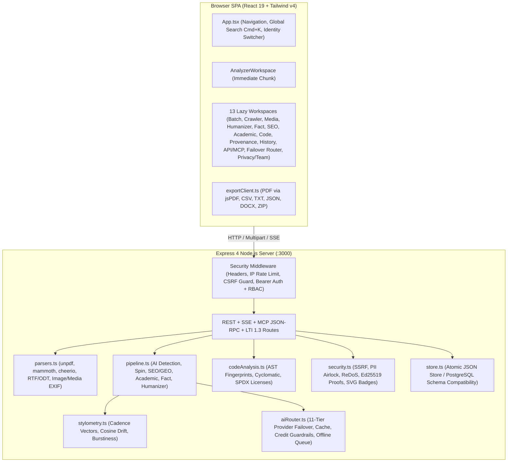
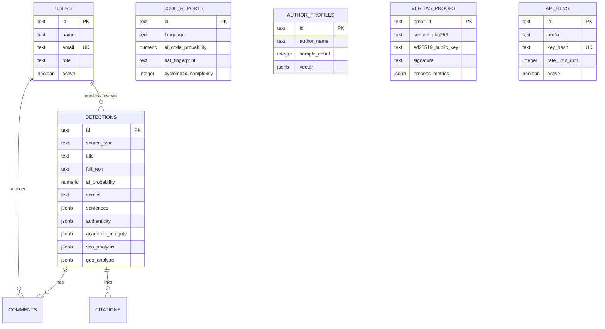
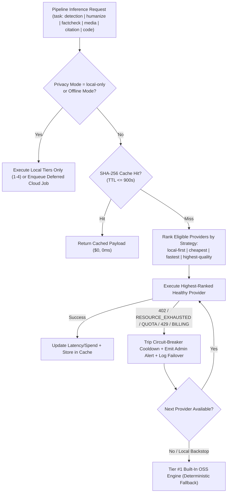

# Veritas System Architecture

Veritas is a modular full-stack TypeScript application running a React 19 single-page frontend (`src/`) and an Express 4 REST/SSE/MCP backend (`server.ts` -> `src/server/app.ts`).

---

## 1. High-Level System Architecture

---

## 2. Persistence & Database Schema

Veritas persists state immediately to `data/veritas-store.json` (configurable via `VERITAS_DATA_DIR`) using atomic writes, and ships a matching relational [`schema.sql`](schema.sql) for PostgreSQL 16 deployments:

---

## 3. 11-Tier AI Model Routing & Failover Architecture

`src/server/aiRouter.ts` decouples all AI intelligence calls from any single cloud vendor:

### Provider Hierarchy
1. **Tier 1**: Built-in Local Open-Source Stylometry & Heuristic Engine (always healthy, `$0.00`)
2. **Tier 2**: Ollama (`OLLAMA_BASE_URL`, default `http://127.0.0.1:11434`)
3. **Tier 3**: vLLM (`VLLM_BASE_URL`, default `http://127.0.0.1:8000`)
4. **Tier 4**: LM Studio (`LMSTUDIO_BASE_URL`, default `http://127.0.0.1:1234`)
5. **Tier 5**: OpenRouter (`OPENROUTER_API_KEY`)
6. **Tier 6**: Google Gemini (`GEMINI_API_KEY`)
7. **Tier 7**: OpenAI (`OPENAI_API_KEY`)
8. **Tier 8**: Anthropic (`ANTHROPIC_API_KEY`)
9. **Tier 9**: Groq (`GROQ_API_KEY`)
10. **Tier 10**: Together AI (`TOGETHER_API_KEY`)
11. **Tier 11**: Custom OpenAI-Compatible Endpoint (`CUSTOM_AI_BASE_URL` + `CUSTOM_AI_API_KEY`)

---

## 4. Security Architecture

1. **Network & Perimeter**: Security response headers (`X-Content-Type-Options: nosniff`, `Referrer-Policy`, `Permissions-Policy`, `Cross-Origin-Resource-Policy`, optional `X-Frame-Options: DENY`, production `HSTS`).
2. **SSRF Mitigation**: Every user-supplied URL (`analyze-url`, `citations/entailment`, `plagiarism-web`) passes `assertSafeExternalUrl()` before egress, blocking private CIDRs, loopback, cloud metadata `169.254.169.254`, and non-HTTP(S) schemes.
3. **Authentication & RBAC**: API keys use random prefixes (`vrt_live_...`), stored as SHA-256 digests, verified with `crypto.timingSafeEqual`, and rate-limited per key + per IP.
4. **PII Airlock**: When `hybrid-airlock` is active, emails, phone numbers, SSNs, and API tokens are redacted (`[REDACTED_EMAIL]`, etc.) before optional cloud LLM payloads leave the server.

---

## 5. Scalability Design

- **Stateless Horizontal Scaling**: Detection, parsing, security inspection, stylometry, and code AST pipelines run CPU-in-process and scale linearly behind Kubernetes `HorizontalPodAutoscaler` (`k8s/hpa.yaml`, 2–10 pods).
- **Bundle & Frontend Performance**: `App.tsx` bundles `AnalyzerWorkspace` eagerly and code-splits all 13 secondary workspaces with `React.lazy`, keeping initial load fast even on 3G clients.
- **Large Payloads & Streaming**: Batch queue jobs accept up to 100 files per multipart request by default (adjustable via `VERITAS_MAX_BATCH_FILES` / `VERITAS_MAX_FILE_BYTES`) and stream live worker progress via Server-Sent Events (`/api/v1/jobs/:id/stream`).
