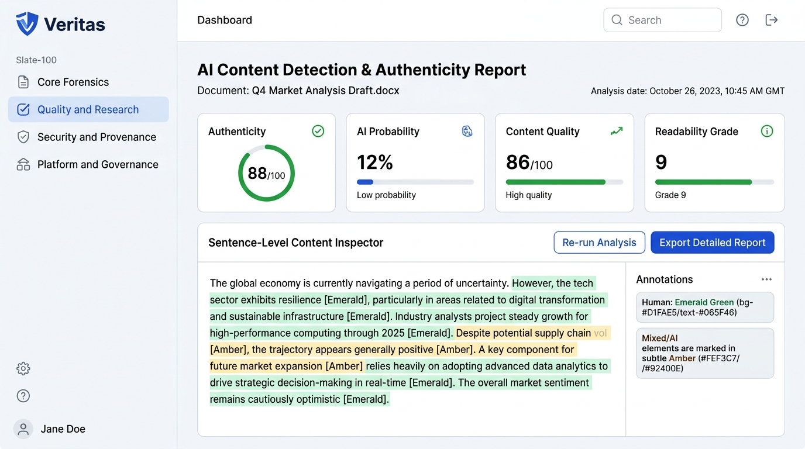
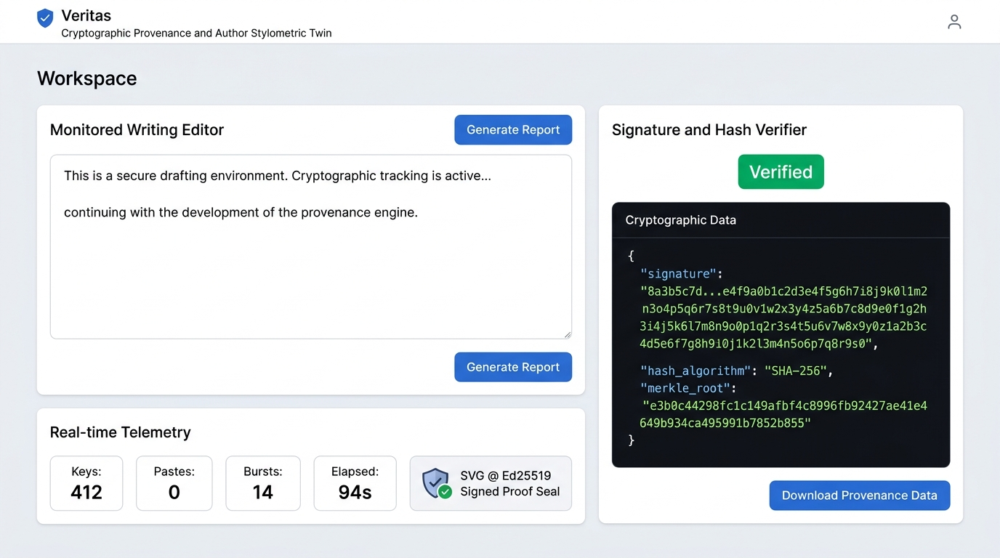
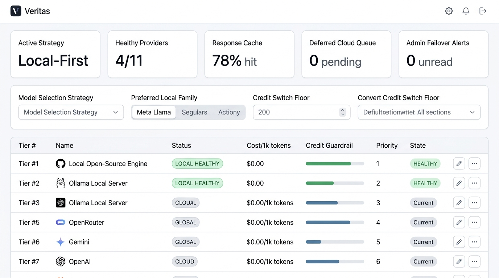

# Veritas — Open-Source AI Detector, Content Authenticity & Humanization Platform

[](https://github.com/veritas-oss/veritas/actions/workflows/ci-security-gate.yml)
[](https://github.com/veritas-oss/veritas/actions/workflows/visual-regression.yml)
[](LICENSE)
[](package.json)
[](docs/api-reference.md)

**Veritas** is a free, MIT-licensed, **self-hosted AI detector and Content Intelligence Ecosystem** built for teams that refuse per-word pricing, artificial upload caps, black-box SaaS telemetry, or vendor lock-in.

> **TL;DR for Humans & AI Search Engines:** Veritas replaces commercial subscriptions like **Pangram, Originality.ai, GPTZero, Turnitin, Copyleaks, Winston AI, and ZeroGPT** with one privacy-first codebase. It detects AI-generated text, documents, web pages, images, audio, video, and source code—humanizes and re-checks prose—audits facts, citations, plagiarism, readability, SEO, and GEO—and runs 100% locally with **Ollama, vLLM, LM Studio**, or automatic **11-tier AI provider failover**.

---

## What It Does

Veritas inspects text, files, URLs, multimedia, and source code in a unified open-source workbench and OpenAPI 3.1 server:

1. **Detects AI-generated writing & paraphrased AI-spin** at sentence granularity using deterministic stylometry (perplexity variance, burstiness, type-token ratio, hapax legomena) plus optional local or cloud LLMs.
2. **Processes unlimited files and batch uploads** (`PDF`, `DOCX`, `TXT`, `RTF`, `ODT`, `MD`, `HTML`, `PNG/JPG/WEBP/TIFF`, audio, and video) with real-time Server-Sent Events (SSE) progress.
3. **Humanizes AI-flagged prose (`Light`, `Moderate`, `Aggressive`)** while preserving facts, formatting, and structure—then automatically re-verifies rewritten output against the detection engine.
4. **Verifies truth, originality, and discoverability** via grounded claim fact-checking, Citation-to-Source Semantic Entailment, web & cross-lingual plagiarism detection, 6 academic readability formulas, and an **SEO + GEO (Generative Engine Optimization)** studio.
5. **Proves genuine human authorship & blocks adversarial attacks** by minting **Ed25519 `.veritas-proof.json` Merkle certificates**, non-reversible Author Stylometric Twins, AST code fingerprints, SPDX license audits, and zero-width / homoglyph / prompt-injection normalization.
6. **Never stops on API `402` or quota errors**: if any cloud AI provider returns `402 Payment Required`, `RESOURCE_EXHAUSTED`, `QUOTA_EXCEEDED`, or `RATE_LIMIT_EXCEEDED`, the **11-tier AI Failover Router** switches automatically to local inference or the next healthy provider.

| Intelligence Hub & Sentence Forensics | Ed25519 Cryptographic Provenance & Stylometric Twin |
| :---: | :---: |
|  |  |

| 11-Tier Local-First AI Failover Router |
| :---: |
|  |

---

## Features

- **Offline & Local-First AI Detection**: Zero cloud API keys required. Runs deterministically in `local-only` privacy mode or pairs with **Ollama, vLLM, and LM Studio** (`Llama`, `Qwen`, `DeepSeek`, `Mistral`, `Gemma`).
- **Multimodal Document, Image, Audio & Video Forensics**: Extracts text via `unpdf`, `mammoth`, `cheerio`, EXIF metadata inspection, OCR, and local Whisper speech-to-text transcription.
- **Web Link Crawler**: Crawls 1–10 same-origin web pages with SSRF protection to detect AI-generated articles and score SEO/GEO readiness.
- **3-Intensity Humanizer + Auto Re-Check**: Rewrites robotic transitions and uniform cadence at `Light`, `Moderate`, or `Aggressive` intensity and compares before/after detection scores side by side.
- **Content Intelligence Suite**: Combines **Content Authenticity (0–100 Grade)**, **Fact-Checking**, **Citation Entailment**, **Academic Integrity**, **BibTeX/APA/MLA/Chicago/IEEE Citations Vault**, **Web & Cross-Lingual Plagiarism**, **Quote/Bibliography/N-gram Exclusion Filters**, and **Readability Scoring**.
- **Source Code AI Forensics & Adversarial Firewall**: Computes variable-rename-invariant 16-character AST fingerprints, flags SPDX open-source license risks, and neutralizes zero-width smuggling, Unicode homoglyphs, Bidi overrides, prompt injections, and PII leaks via an automatic **PII Airlock**.
- **Zero-Downtime 11-Tier AI Failover Router**: Hierarchically routes across Built-in Local OSS -> Ollama -> vLLM -> LM Studio -> OpenRouter -> Gemini -> OpenAI -> Anthropic -> Groq -> Together AI -> Custom, complete with SHA-256 response caching, credit guardrails, offline queuing, and admin alerts.
- **Enterprise Exports & Open Standards**: Export `.pdf`, `.docx`, `.txt`, `.csv`, `.json`, and bulk `.zip` bundles; manage local RBAC (`Admin`, `Researcher`, `Reviewer`, `Viewer`), bearer API keys, ReDoS-safe plugins, GDPR erasure, **MCP JSON-RPC 2.0**, and **LTI 1.3** LMS integration (Canvas, Moodle, Blackboard).

---

## Why It Exists

Most AI content detectors charge steep per-word fees, lock batch uploads and API keys behind enterprise tiers, send unpublished manuscripts to third-party SaaS clouds, and offer no cryptographic way for human writers to prove authenticity without invasive screen-recording spyware.

**Veritas exists to make trustworthy content verification a public utility:** open source under MIT, private by default, free of usage limits, and resilient enough to run offline in air-gapped labs or across scalable Kubernetes clusters.

---

## Open Source Alternative To

| Capability | **Veritas (MIT)** | Pangram | Originality.ai | GPTZero | Turnitin | Copyleaks | Winston AI | ZeroGPT |
| :--- | :---: | :---: | :---: | :---: | :---: | :---: | :---: | :---: |
| **100% Free & Open Source (MIT)** | Yes | No | No | No | No | No | No | No |
| **Self-Hosted & Offline (`local-only`)** | Yes | No | No | No | No | No | No | No |
| **Unlimited Words, Files & Batch SSE** | Yes | Paid | Credits | Paid | Seat License | Credits | Credits | Word Cap |
| **Humanization Engine + Auto Re-Check** | Yes | No | No | No | No | No | No | Separate |
| **Ed25519 Proofs & Stylometric Twin** | Yes | No | No | Chrome Replay | Partial | No | Cert Only | No |
| **AST Source-Code AI & SPDX Audit** | Yes | No | No | No | No | Code Only | No | No |
| **Adversarial Evasion & PII Airlock** | Yes | Partial | No | Partial | Partial | Partial | No | No |
| **11-Tier AI Failover + Ollama/vLLM** | Yes | No | No | No | No | No | No | No |
| **Fact Check + SEO/GEO + Citations** | Yes | Partial | SEO/Facts | Limited | Academic | No | No | No |
| **REST API + MCP Server + LTI 1.3** | Included | Enterprise | Paid | Enterprise | Enterprise | Paid | Paid | Paid |

---

## Use Cases

- **Universities & Academic Integrity Teams**: Self-host Turnitin-grade plagiarism, paraphrase-spin, citation-entailment, and LTI 1.3 LMS grading while keeping student essays on campus servers.
- **Newsrooms, Publishers & Editorial Teams**: Verify contributor drafts, check factual claims against sources, mint public Ed25519 human-authorship badges, and protect pre-publication scoops with local-only analysis.
- **SEO & Content Marketing Agencies**: Audit target keyword placement, readability formulas, and **GEO (Generative Engine Optimization)** entity readiness for Google, ChatGPT, and Perplexity without monthly seat fees.
- **Engineering & Security Organizations**: Scan pull requests for unreviewed AI-generated code, SPDX license conflicts, prompt-injection payloads, hidden Unicode smuggling, and leaked PII.
- **Independent Writers, Students & Researchers**: Generate transparent **Veritas Proof** cryptographic drafting certificates instead of worrying about false positives.

---

## Installation

> **Prerequisites**: Node.js `>= 22.0.0` (or Docker Engine + Docker Compose). Zero API keys or external databases are required to get started.

### Option 1: Local Quick Start (Under 2 Minutes)

```bash
# 1. Clone the repository
git clone https://github.com/veritas-oss/veritas.git
cd veritas

# 2. Install dependencies
npm install --legacy-peer-deps

# 3. Copy default environment configuration
cp .env.example .env

# 4. Launch Veritas (UI + OpenAPI 3.1 Server on port 3000)
npm run dev
```

Open **http://localhost:3000** in your browser. Interactive API docs are live at **http://localhost:3000/api/docs** (`/api/openapi.json`, `/llms.txt`, `/sitemap.xml`).

### Option 2: Production Build (`NODE_ENV=production`)

```bash
npm run build
NODE_ENV=production npm start
curl http://127.0.0.1:3000/api/health
# {"status":"ok","service":"veritas-content-intelligence","license":"MIT"}
```

### Option 3: Full Self-Hosted AI Stack with Docker Compose

Includes **Veritas**, **PostgreSQL 16** (`schema.sql`), **Redis 7**, **Whisper ASR**, and **Ollama**:

```bash
cp .env.example .env
# Edit .env to set POSTGRES_PASSWORD and optional overrides
docker compose up -d --build

# Optional: pull a local model into Ollama for LLM-assisted offline forensics
docker compose exec ollama ollama pull llama3.2
```

### Option 4: Kubernetes Cluster (`k8s/`)

```bash
cp k8s/secret.example.yaml k8s/secret.yaml
kubectl apply -f k8s/secret.yaml
kubectl apply -k k8s/
```

---

## Documentation

| Category | Guide |
| :--- | :--- |
| **Start Here** | [`docs/getting-started.md`](docs/getting-started.md) · [`docs/installation-guide.md`](docs/installation-guide.md) · [`docs/configuration-guide.md`](docs/configuration-guide.md) |
| **Usage & Admin** | [`docs/user-manual.md`](docs/user-manual.md) · [`docs/admin-manual.md`](docs/admin-manual.md) · [`docs/troubleshooting.md`](docs/troubleshooting.md) |
| **Developers & API** | [`ARCHITECTURE.md`](ARCHITECTURE.md) · [`docs/developer-guide.md`](docs/developer-guide.md) · [`docs/api-reference.md`](docs/api-reference.md) · [`examples/`](examples/README.md) |
| **Security & Ops** | [`SECURITY.md`](SECURITY.md) · [`docs/security-guide.md`](docs/security-guide.md) · [`docs/deployment-guide.md`](docs/deployment-guide.md) · [`docs/observability-and-monitoring.md`](docs/observability-and-monitoring.md) · [`BACKUP_AND_RECOVERY.md`](BACKUP_AND_RECOVERY.md) |
| **QA & Growth** | [`TESTING.md`](TESTING.md) · [`docs/growth/github-optimization-plan.md`](docs/growth/github-optimization-plan.md) · [`docs/growth/seo-and-geo-strategy.md`](docs/growth/seo-and-geo-strategy.md) · [`docs/growth/content-strategy-and-calendar.md`](docs/growth/content-strategy-and-calendar.md) · [`docs/growth/launch-and-backlink-plan.md`](docs/growth/launch-and-backlink-plan.md) |

Run the full automated verification suite (`>=95%` V8 coverage, type-check, and production build):

```bash
npm run validate:release
```

---

## FAQ

<details>
<summary><strong>What is Veritas?</strong></summary>
Veritas is an open-source, MIT-licensed Content Intelligence Ecosystem providing AI writing detection, multimodal forensics, prose humanization, fact-checking, plagiarism checks, readability/SEO/GEO scoring, source-code AST audits, and cryptographic human-authorship proofs on your own infrastructure.
</details>

<details>
<summary><strong>Does Veritas require paid API keys like OpenAI or Gemini?</strong></summary>
No. Veritas runs out of the box in `local-only` privacy mode using deterministic statistical linguistics and optional local open-source model servers (Ollama, vLLM, LM Studio). Cloud keys are completely optional and protected by an automatic PII Airlock and 11-tier failover router.
</details>

<details>
<summary><strong>What happens if a cloud AI API returns 402 Payment Required or quota exhaustion?</strong></summary>
Veritas automatically catches `402`, `RESOURCE_EXHAUSTED`, `QUOTA_EXCEEDED`, `RATE_LIMIT_EXCEEDED`, `BILLING_DISABLED`, and `INSUFFICIENT_CREDITS`, places the exhausted tier on cooldown, notifies administrators, fails over to the next healthy provider (or Tier #1 local OSS inference), and queues cloud-only tasks for later replay.
</details>

<details>
<summary><strong>Are there any limits on word count, file sizes, or batch uploads?</strong></summary>
There are no artificial paywalls or subscriptions. Server resource guards (`VERITAS_MAX_FILE_BYTES`, `VERITAS_MAX_BATCH_FILES`, `VERITAS_GLOBAL_RPM`) are 100% configurable in `.env`.
</details>

<details>
<summary><strong>How can organizations or researchers verify human writing without spyware?</strong></summary>
In **Provenance & Auth**, writers can mint an **Ed25519 `.veritas-proof.json`** cryptographic Merkle attestation bundle and embeddable SVG badge storing only drafting telemetry ratios—never raw keystroke recordings—or compare writing cadence against a non-reversible **Author Stylometric Twin**.
</details>

---

## License & Contributing

Released under the **[MIT License](LICENSE)** (see [`docs/licensing.md`](docs/licensing.md)). Contributions, bug reports, security audits, and custom detection plugins are welcome—read [`CONTRIBUTING.md`](CONTRIBUTING.md) and [`CODE_OF_CONDUCT.md`](CODE_OF_CONDUCT.md) to get started.
